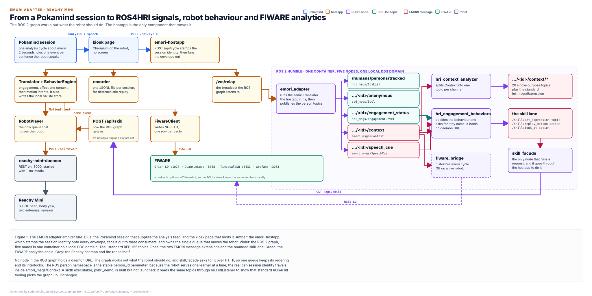

# EMORI architecture, one page



Regenerate with `python scripts/build_emori_system_graph.py`; the script's docstring gives
the headless-Chromium command that renders a PNG of the same file. Never edit the figure
by hand.

This figure shows the system as it is implemented. Every topic path, message type, route
and port on the canvas is copied from the source it labels.

## There is a v2, and this page is v1

Everything below describes **v1**: the default configuration, in which Pollen's
`reachy-mini-daemon` owns the motors and the ROS graph is an observer that asks the
hostapp to move them. A second configuration exists and is built.
In **v2** the daemon is gone: `reachy_mini_ros2` owns Pollen's `Backend` object
in-process, publishes `/joint_states`, `/tf`, `/reachy_mini/head_pose`,
`/reachy_mini/motion_status` and `/diagnostics`, serves `GoTo` and `PlayRecordedMove`
actions, arbitrates every client through one three-lane arbiter, and answers the daemon's
own REST dialect on `:8000` through a compatibility shim — so the hostapp and everything on
this page keep working with no change at all. `emori_skill_facade` gains a `ros_native`
transport (`emori_skill_native`) that reaches those actions directly, with no HTTP hop.
v2 runs on the real robot and is opt-in; v1 stays the default. The figure is
[`emori-v2-native-robot.svg`](emori-v2-native-robot.svg)
(`scripts/build_emori_v2_graph.py`) and the write-up, with the CM4 install routes, how to
verify it and the open risks, is
[`../ros2-v2-native-robot.md`](../ros2-v2-native-robot.md).

## How to read it

Colour carries the grouping. Blue is the Pokamind session and the kiosk page that hosts
it. Amber is the hostapp. Violet is a ROS 2 node. Teal is a standard REP-155 topic, rose
is an EMORI message extension, and the split between those two colours is the whole
ROS4HRI compliance story in one glance. Green is the FIWARE chain, grey is the robot.

A Pokamind session emits an analysis cycle about every two seconds, plus one event per
sentence the robot speaks. The kiosk page relays each envelope to `POST /api/cycle`, which
stamps the session identity and fans it out to the in-process driver, the recorder and the
`/ws/relay` broadcast. `emori_adapter` reads that broadcast, runs the same pure-Python
`Translator` the hostapp runs, and publishes the person topics. The analyzer splits
`Context` into one topic per channel, the engagement node names a bounded motion on the
`/skill` lane, and `skill_facade` runs it by posting back to the hostapp.

## The five nodes, in six packages

One launch file brings all five up in one container, so their DDS graph stays local:

```bash
ros2 launch emori_adapter_bringup slice2.launch.py
```

| Node | Package | What it does |
|---|---|---|
| `emori_adapter` | `emori_adapter_ros` | publishes the person topics from the live relay, or from a deterministic mock arc |
| `hri_context_analyzer` | `hri_context_analyzer` | Splits `Context` into single-purpose scalar topics |
| `hri_engagement_behaviors` | `hri_engagement_behaviors` | The engagement authority. It names a motion, it never writes one |
| `skill_facade` | `emori_skill_facade` | the only node that runs a request, and only through the hostapp |
| `fiware_bridge` | `fiware_bridge` | NGSI-LD historization, launched under `IfCondition(with_fiware)` |

Four of those packages — `emori_msgs`, `hri_context_analyzer`,
`hri_engagement_behaviors` and `emori_skill_facade` — are standalone: they import nothing
from `emori_adapter`. `deploy/ros2/Dockerfile.standalone` builds exactly those four on a
plain Humble with `ros-humble-hri-msgs`, no pip install of the core, and starts their
three nodes; `scripts/ros_standalone_check.py` runs it and CI has it as `ros2-standalone`.
An `ImportError` shows up there as a missing node, which is the point.

A sixth executable, `pyhri_demo`, is built but not launched. It reads the same topics
through `hri.HRIListener` to show that standard ROS4HRI tooling picks the graph up
unchanged.

The graph is opt-in on a robot. `deploy/robot/install.sh` installs the container only when
`EMORI_WITH_ROS2=1`.

Each of the three decision-side nodes keeps its judgement in a pure, ROS-free module that
is unit-tested on a host with no ROS installed at all:
`ros2_ws/src/open/hri_context_analyzer/hri_context_analyzer/contracts.py`
(`plan_fan_out` decides which of the 21 topics this cycle may publish),
`ros2_ws/src/open/hri_engagement_behaviors/hri_engagement_behaviors/policy.py` (the ladder,
the yield rule, the cue budget), and
`ros2_ws/src/open/emori_skill_facade/emori_skill_facade/contract.py` (the counters, the
request bodies, the error-code mapping). The node files around them are plumbing.

## The interfaces

`emori_adapter` publishes:

| Topic | Type | QoS | |
|---|---|---|---|
| `/humans/persons/tracked` | `hri_msgs/IdsList` | transient_local, depth 1 | REP-155 |
| `/humans/persons/<id>/anonymous` | `std_msgs/Bool` | transient_local, depth 1 | REP-155 |
| `/humans/persons/<id>/engagement_status` | `hri_msgs/EngagementLevel` | volatile, depth 10 | REP-155 |
| `/humans/persons/<id>/context` | `emori_msgs/Context` | volatile, depth 10 | EMORI extension |
| `/humans/persons/<id>/speech_cue` | `emori_msgs/SpeechCue` | volatile, depth 10 | EMORI extension |

Latched topics use `transient_local` so that late subscribers, including `pyhri`'s
`HRIListener`, see the last value. Mismatched QoS is the usual reason a subscriber sees
nothing.

`hri_context_analyzer` republishes 20 `std_msgs` scalars under
`/humans/persons/<id>/context/...` plus the standard `/humans/persons/<id>/expression`.
That is 21 publishers, 9 of which publish every cycle and 12 of which are flag-gated. The
`Expression` field type is read by introspection at startup rather than assumed, because
it is a `string` in some `hri_msgs` releases and a `uint8` with class constants in others.

`hri_engagement_behaviors` emits, and `skill_facade` serves:

| Interface | Type | Kind |
|---|---|---|
| `/skill/set_expression` | `emori_msgs/SetExpression` | topic, because an expression is fire-and-forget state |
| `/skill/replay_motion` | `emori_msgs/action/ReplayMotion` | action |
| `/skill/look_at` | `emori_msgs/action/LookAt` | action |

`hri_engagement_behaviors` emits at most **one** request per event: a de-escalation cycle
is a single `calm_settle` and nothing else, a cycle inside a sentence's speaking budget
publishes nothing at all, and an expression is requested only when the label changes.
A sentence is one request that owns the head for `min(est_duration, cue_max_s)`.

Both `hri_engagement_behaviors` and `skill_facade` publish a counter ledger on
`/diagnostics` (`diagnostic_msgs/DiagnosticArray`) every 5 s, so a run can be audited
from outside without reading logs.
`ros2_ws/src/open/emori_skill_facade/emori_skill_facade/transport.py` is a plug point:
`EMORI_SKILL_TRANSPORT` selects `hostapp_http` (the default) or `log`, and another robot
skill interface would be one more class there plus one launch argument.

Field-level detail, the QoS rationale, the `Context.msg` constants and the privacy gate
are in [`../ros4hri-mapping.md`](../ros4hri-mapping.md). The definitions themselves live
in `ros2_ws/src/open/emori_msgs/{msg,action}/`.

### Inspect it at runtime

```bash
ros2 topic list | grep -E "/humans|/skill"
ros2 topic echo /humans/persons/learner_01/engagement_status
ros2 topic echo /humans/persons/learner_01/speech_cue    # only while the robot is speaking
ros2 interface show emori_msgs/msg/Context
ros2 action list
```

A name in `ros2 topic list` is not evidence of data. All 21 analyzer publishers are created
at startup whether or not a message ever crosses them.

## Why it is built this way

The hostapp owns the only queue that moves the robot, and no node in the ROS graph holds a
Reachy daemon URL. A contract test walks `ros2_ws/` and asserts that `/api/move/` appears
nowhere in it. Everything reaches the robot through one `RobotPlayer` queue, which keeps
its generation guard, its `drop_if_busy` rule, the busy gate the push-turn detector needs,
and the add-on ownership check. A node posting to the daemon would step around all four.

The graph decides but does not execute. `EMORI_ROS_MOTION_OWNER` takes `hostapp` (the
default), `ros` or `none`, and both sides enforce it: the facade will not post, and the
intake answers 409 `not_owner`. The engagement node computes and publishes either way, so
the knob changes who executes, not who decides. The intake has four more gates in front of
it (flag and secret, loopback, rate limit, owner) and it is not even mounted without
`EMORI_SKILL_API=1` and a non-empty `EMORI_SKILL_KEY`.

All three modes can be rehearsed end to end in the simulator, with counters read from
both sides and the robot's head pose sampled at 4 Hz
([`../motion-owner-rehearsal.md`](../motion-owner-rehearsal.md)). At `owner=hostapp` the
behaviours node computes exactly the requests it computes at `owner=ros`, and the facade
refuses every one of them: turning the graph on is a non-event.

An outside ROS consumer with no EMORI code can read the graph: an `hri_msgs`-only node in a
separate container subscribes to `tracked`, `engagement_status` and `expression`; see
`scripts/outside_consumer_check.py`. It cannot decode `emori_msgs/msg/Context`, which is
the boundary of "standard ROS4HRI": the EMORI extensions need `emori_msgs`. Identities on the wire
are pseudonyms (`EMORI_ROS_DEIDENTIFY=1` by default) and the robot's speech text is off
by default (`EMORI_ROS_SPEECH_TEXT=0`), because `ROS_LOCALHOST_ONLY` is the only access
control DDS gives us.

There are two identities on purpose. The ROS person namespace is the stable `person_id`
parameter, because the robot serves one learner at a time and the REP-155 tree should not
churn between sessions. The real per-session identity travels inside `emori_msgs/Context`,
and identity-keyed consumers such as the FIWARE bridge read those fields rather than the
topic name.

An absent channel is not a zero. Every v2 float in `Context` uses -1.0 to mean not
reported, and a flag-gated topic is not published at all when its channel said nothing. A
subscriber sees an absent or stale topic, which it can detect, rather than a fabricated
0.0. "Nobody looked at this learner" and "this learner scored zero" are different sessions,
and treating them as the same is how a KPI gets poisoned. `degraded` is the exception,
because silence on a health signal looks the same as a dead node.

`SpeechCue` carries the robot's own voice, not the learner's. `hri_msgs/LiveSpeech` is for
what the human said. This message is published per sentence at that sentence's playback
onset, with `est_duration` of 0.333 times the word count clamped to 0.9 to 6.0 seconds,
because a behaviour node has to move the head while the sentence is being spoken. A mock
arc has no voice, so it publishes no cue at all.

## What is off by default

The whole ROS graph needs `EMORI_WITH_ROS2=1`. `skill_facade` computes, counts and logs but
posts nothing on the shipped `EMORI_ROS_MOTION_OWNER=hostapp`, over the shipped
`EMORI_SKILL_TRANSPORT=hostapp_http`. `EMORI_ROS_OWNER_FALLBACK_S` is `0`, i.e. the
hostapp never silently takes expressive motion back from a quiet ROS lane; it exists for
an unattended venue and it invalidates any measurement it is turned on for. The two
privacy knobs default the *protective* way round: `EMORI_ROS_DEIDENTIFY=1` and
`EMORI_ROS_SPEECH_TEXT=0`, and only an exact `0/false/no/off` turns either off, so a typo
cannot open the wire. `fiware_bridge` runs with
`FIWARE_BRIDGE_ENABLED=0` on a live robot, because the hostapp already historizes every
cycle and two writers would double every time-series row. The hostapp's own NGSI-LD write
degrades to a no-op after one failed reachability probe, since a broker is an optional
off-robot dependency. The SQLite store is written on every cycle regardless, and
`/dashboard` serves 503 until `EMORI_DASH_PASSWORD` is set.
