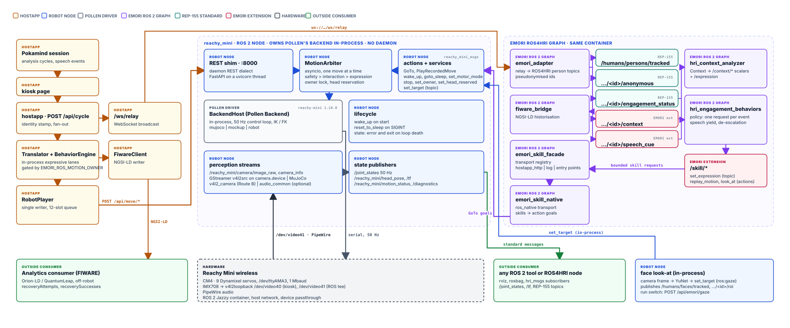

# v2: the robot as a native ROS 2 node

The figure: [`architecture/emori-v2-native-robot.svg`](architecture/emori-v2-native-robot.svg).



> **Status.** v2 is built and runs on the real robot through Route A (Docker): the serial
> backend, the REST shim, the arbiter and face look-at on the camera tee. Route B (native,
> pixi + RoboStack) has not been run on hardware. v1 (Pollen's daemon) remains the default.
> The deployment table and the step-by-step changeover are in
> [`deploy/robot/ros2_native/README.md`](../deploy/robot/ros2_native/README.md).

---

## Why v2

v1 left the robot outside the ROS 2 graph. `hri_engagement_behaviors` decided that the
head should move, `emori_skill_facade` posted that decision back to the hostapp over
HTTP, the hostapp's `RobotPlayer` queued it, and `RobotPlayer` posted it again to Pollen's
`reachy-mini-daemon` on `localhost:8000`. The robot itself published nothing: no
`/joint_states`, no `/tf`, no camera, no motion status. An outside ROS 2 consumer could
read everything EMORI knew about the *human* and nothing at all about the *robot*.

That is a real gap for an HRI system built on ROS 2. It also made two questions
unanswerable in ROS terms: what is the robot doing right now, and who is allowed to move
it next.

So: **can Pollen's daemon be replaced by a ROS 2 node that owns the robot directly, without
losing the hostapp, the arbitration rules, or a single behaviour?**

## How it works

Pollen's `reachy_mini` package is a thin FastAPI daemon wrapped
around a **transport-free `Backend` class** — nothing in `Backend`, its three subclasses,
the kinematics engines or `motion/` imports FastAPI or uvicorn. A Python ROS 2 node can
therefore construct that `Backend` in-process, install Pollen's own `Publisher` hooks on
it, and republish the 50 Hz state as `/joint_states`, `/tf` and `/reachy_mini/head_pose`
while serving `GoTo` and `PlayRecordedMove` actions. The v1 arbitration rules (lanes,
preemption, drop-if-busy, head reservation, owner lock) move *into* that node, where the
motion actually happens, so the hostapp and the ROS graph are arbitrated in one place
instead of two. A REST compatibility shim inside the node answers the daemon's own dialect
on `:8000`, so the hostapp is not modified at all — not one line.

In the MuJoCo simulator, in a container, the graph comes up as five nodes and 36 topics
(not counting `/rosout` and `/parameter_events`),
`/joint_states` runs at about 47 Hz and a 0.5 s `GoTo` completes with about 13 ms of
overhead. On the robot, `/joint_states` holds 48–49 Hz off the real control loop.

---

## What the daemon actually is

This is the finding the rest of the work rests on, so it is worth stating precisely.

`reachy_mini.daemon.Daemon` wraps three things: a `Backend`, a `WSServer`, and an optional
`GstMediaServer`. The FastAPI coupling is confined to `daemon/app/*` and `io/ws_server.py`.
`Backend` itself — and `MujocoBackend`, `MockupSimBackend`, `RobotBackend`, the three
kinematics engines and everything under `motion/` — references neither FastAPI nor uvicorn,
installs no signal handlers, and needs no event loop of its own.

The surface a node needs is small:

| What | How |
|---|---|
| lifecycle | `wrapped_run()` runs `run()` in the caller's thread; `ready` and `should_stop` are `threading.Event`s; `close()` |
| streaming target | `set_target(head=4×4 or None, antennas=[right, left] or None, body_yaw)` |
| interpolated move | `goto_target(head, antennas, duration, method: InterpolationTechnique, body_yaw)` — a coroutine that builds a `GotoMove` and plays it at 100 Hz under an `RLock`: **one move at a time** |
| canned moves | `wake_up()`, `goto_sleep()`, `play_move(move)`, all coroutines; `RecordedMoves(dataset).get(name)` reads Hugging Face datasets (85 moves in `pollen-robotics/reachy-mini-emotions-library`) |
| state | `get_present_head_pose()` (4×4), `get_present_head_joint_positions()` (7: body yaw + six Stewart), `get_present_antenna_joint_positions()` (2, `[right, left]`), `get_motor_control_mode()` |
| state push | `set_pose_publisher(Publisher)` / `set_joint_positions_publisher(Publisher)`, where `Publisher` wraps any `Callable[[str], None]` and the messages are JSON |
| stopping a move | cancel the `asyncio.Task` — which is exactly what the daemon's own `POST /api/move/stop` does |

The backends differ only in what they drive. `MujocoBackend` runs 500 Hz physics and a
50 Hz control loop and treats motor modes as no-ops; `MockupSimBackend` has no physics at
all and just copies targets at 50 Hz; `RobotBackend` opens the serial port and hands it to
Pollen's Rust `ReachyMiniPyControlLoop` at 50 Hz and 1 Mbaud, nine motors, PID from
`assets/config/hardware_config.yaml`. The same node code drives all three; `backend` is a
launch parameter.

Two platform facts shaped the build. `reachy-mini` 1.10.0 requires Python ≥ 3.11, which
rules Humble out and makes **Jazzy** (Ubuntu 24.04, Python 3.12) the target; and Pollen's
Rust wheels (`reachy_mini_motor_controller`, `reachy_mini_rust_kinematics`, `rustypot`)
ship `manylinux_2_17_aarch64` for cp310–cp313, so the CM4 is covered. There is **no
official Pollen ROS 2 support** — the repository, the Hugging Face docs and the ROS index
all agree; the only community attempt is a two-commit stub, and the URDF that ships in
Pollen's repo is reported invalid.

Sources: [pollen-robotics/reachy_mini](https://github.com/pollen-robotics/reachy_mini),
[reachy-mini-motor-controller](https://github.com/pollen-robotics/reachy-mini-motor-controller),
[reachy_mini_rust_kinematics](https://github.com/pollen-robotics/reachy_mini_rust_kinematics),
[issue #761 (the URDF)](https://github.com/pollen-robotics/reachy_mini/issues/761),
[the SDK install docs](https://huggingface.co/docs/reachy_mini/en/SDK/installation),
[tianrking/reachy_mini_ros2](https://github.com/tianrking/reachy_mini_ros2),
[PyPI `reachy-mini`](https://pypi.org/pypi/reachy-mini/json).

## Running Pollen's backend without the daemon

Pollen's backend runs with **no daemon process at all**, headless, in a container
(`MUJOCO_GL=egl`, no GPU). The sequence the node relies on:

| Step | Result |
|---|---|
| `MujocoBackend(scene="empty", headless=True, use_audio=False, kinematics_engine="AnalyticalKinematics")` | constructed in about 0.5 s |
| `threading.Thread(target=backend.wrapped_run)`; `backend.ready.wait()` | ready almost at once |
| `set_motor_control_mode(Enabled)`; `await backend.wake_up()` | done in about 2 s more |
| `await backend.goto_target(head=4×4, antennas=[0.3, -0.3], duration=0.6, method=MIN_JERK, body_yaw=0.0)` | the head moves and the antennas read back the target |
| `set_pose_publisher` / `set_joint_positions_publisher` | messages at 50 Hz, exactly the control-loop rate |
| `RecordedMoves("pollen-robotics/reachy-mini-emotions-library")` | **85 moves**; `play_move` runs and `task.cancel()` stops it |
| `mujoco.Renderer(model, 240, 320)` on camera `eye_camera` | a **240×320×3** uint8 frame, offscreen, through EGL |
| `should_stop.set()`; `close()` | clean exit |

Four gotchas are baked into the node: publishers must be `Publisher` objects and not bare
callables; `ready`/`should_stop` are `threading.Event`s, not asyncio ones;
`wake_up`/`goto_target`/`play_move`/`goto_sleep` are coroutines and must live on one
asyncio loop in a dedicated thread (cancellation is `Task.cancel()`); and the simulator's
own rendering thread only starts when `headless=False`, so a headless node has to render
the camera itself.

---

## The design

### Components

Three packages, plus one edit to an existing one.

| Package | Kind | What it is |
|---|---|---|
| `reachy_mini_msgs` | ament_cmake | the interfaces: 2 msg, 2 action, 3 srv. Apache-2.0, no EMORI dependency |
| `reachy_mini_ros2` | ament_python | `backend_host.py`, `arbiter.py`, `conversions.py`, `rest_shim.py`, `robot_node.py`, `launch/robot.launch.py`. **Imports nothing from `emori_adapter`** — a test asserts it |
| `emori_skill_native` | ament_python | the `ros_native` transport. It *does* import the `emori_adapter` core, so it lives in `ros2_ws/src/emori/` |
| `emori_skill_facade` | edited | `transport.py` has a registry; `facade_node.py` passes `node=self` to the factory |

`reachy_mini_ros2` and `reachy_mini_msgs` know nothing about EMORI; `emori_skill_native`
is the only piece that joins the two worlds. The four standalone ROS4HRI packages
(`emori_msgs`, `hri_context_analyzer`, `hri_engagement_behaviors`, `emori_skill_facade`)
are unchanged in character and still import nothing from the core.

### Interfaces

Units are metres and radians everywhere. `antennas` is `[right, left]` — the daemon's wire
order. `head_pose` is the head frame relative to `base_link`. Joint names, in order:
`body_yaw, stewart_1 … stewart_6, right_antenna, left_antenna`.

| Interface | Type | Fields |
|---|---|---|
| `/joint_states` | `sensor_msgs/JointState` | all nine joints, ≈50 Hz, straight off Pollen's publisher hook |
| `/reachy_mini/head_pose` | `geometry_msgs/PoseStamped` | the present head pose |
| `/tf` | `tf2_msgs/TFMessage` | `base_link → head` |
| `/reachy_mini/motion_status` | `reachy_mini_msgs/MotionStatus` | `busy, running_move_id, queue_depth, owner, head_reserved, expression_owner, motor_mode, backend`. Latched (`transient_local`, depth 1), published on change and every 1 s |
| `/reachy_mini/set_target` | `reachy_mini_msgs/BodyTarget` | streaming target: `use_head, head_pose, use_antennas, antennas[2], use_body_yaw, body_yaw` |
| `/reachy_mini/camera/image_raw` + `camera_info` | `sensor_msgs/Image`, `CameraInfo` | rgb8. MuJoCo's `eye_camera` in sim; on the robot the node's own capture, or `v4l2_camera` |
| `/diagnostics` | `diagnostic_msgs/DiagnosticArray` | status `reachy_mini`: backend, ready, motor mode, measured joint and camera rates, every arbiter counter |
| `/reachy_mini/goto` | `reachy_mini_msgs/action/GoTo` | goal `use_head, head_pose, use_antennas, antennas[2], use_body_yaw, body_yaw, duration, interpolation, lane, client, preempt, reason` → result `completed, error_code, move_id` → feedback `progress` |
| `/reachy_mini/play_recorded_move` | `.../action/PlayRecordedMove` | goal `dataset, name, lane, client, preempt, reason` → same result and feedback |
| `/reachy_mini/set_motor_mode` | `.../srv/SetMotorMode` | `mode` → `ok, message, mode` |
| `/reachy_mini/stop` | `.../srv/StopMove` | `move_id` (empty = all) → `stopped` |
| `/reachy_mini/set_owner` | `.../srv/SetOwner` | `client, ttl_s` (empty client = release) → `ok, owner` |
| `/reachy_mini/wake_up`, `/reachy_mini/goto_sleep` | `std_srvs/Trigger` | interaction lane, waits ≤ 5 s |
| `/reachy_mini/set_head_reserved` | `std_srvs/SetBool` | the push-turn reservation |
| `/humans/faces/tracked` | `hri_msgs/IdsList` | the locked face id, or `[]`; latched. Only when face look-at was built ([below](#face-look-at)) |
| `/humans/faces/<id>/roi` | `hri_msgs/NormalizedRegionOfInterest2D` | frame `eye_camera`; one at a time, while a face is locked |

Frames: the only transform is `base_link → head` on `/tf`; there is no `/tf_static`, no
URDF and no `robot_description`. Images, `CameraInfo` and the face ROIs carry frame_id
`eye_camera`, which is not connected to the tree. `/joint_states` has `name` and
`position` only (no velocity or effort). `CameraInfo` is nominal (K from
`camera.fovy_deg`, 60° on a robot; D = 0), not calibrated. Every channel of the whole
graph is indexed in [ros4hri-mapping.md](ros4hri-mapping.md#every-ros-channel-at-a-glance).

One wart: **`GoTo.Feedback.progress` is wall-clock elapsed divided by the budget**, not
true trajectory progress, because the backend does not expose one. For a recorded move the
budget is the 120 s ceiling, so its progress bar sits near zero for the whole move. It is
reported that way rather than guessed.

### The arbiter

`ros2_ws/src/open/reachy_mini_ros2/reachy_mini_ros2/arbiter.py` is pure Python — asyncio,
numpy, stdlib, **no rclpy** — and
is unit-tested on a host with no ROS installed (`tests/test_reachy_arbiter.py`). It is the
v1 `RobotPlayer` rules, moved to where the motion happens and made thread-safe, because it
is called both from rclpy callbacks and from the shim's HTTP threadpool.

Three lanes, priority high to low: **safety > interaction > expression**.

`submit()` applies these rules in this order, and the first one that matches refuses:

1. unknown lane → `bad_lane`
2. the owner lock is held by another client and the lane is not `safety` → `not_owner`
3. expression lane and (`expression_owner == "none"` or `client != expression_owner`) → `not_owner`
4. expression lane and the head is reserved → `head_reserved`
5. expression lane, a move is running and the queue depth is ≥ 2 → `dropped`
6. the queue is full → `queue_full`

Before all of them, a request to an arbiter that is closing (the node is shutting down) is
refused `backend_error`.

**Client names may carry a sub-client after a colon.** Rule 3 compares
`owner_of(client)` — everything before the first `:`, lowercased — against the expression
owner, so `ros:gaze` belongs to owner `ros` and is arbitrated exactly as `ros` is. A name
with no colon is unchanged, which is why `hostapp` and `ros` behave as they always have.
The point of the suffix is the per-client counters: `accepted_ros:gaze` gets its own line
on `/diagnostics` beside `accepted_ros`, so a 5 Hz look-at stream can be read separately
from the graph's gestures without inventing a second ownership concept. Rule 2 — the
exclusive owner lock — is deliberately **not** relaxed the same way: a lock is a lock, and
`ros` holding one should still lock out `ros:gaze`.

Then: a **safety** request cancels the running move, flushes every queued *expression*
request, and goes to the front (behind any safety already waiting, so safety stays FIFO
among itself). An **interaction** request with `preempt=True` cancels a running
*expression* move only. `set_target` is never queued and answers `busy` while a move runs,
which is the daemon's `{"status": "ignored"}` by another name.

The seven refusal codes are `bad_lane`, `not_owner`, `head_reserved`, `dropped`,
`queue_full`, `busy`, `backend_error`. They are deliberately the same vocabulary the
facade's ledger already counts, so a refusal reads the same on both sides of the wire.
**A refusal is an answer, not a failure**: an action goal that is refused still
`succeed()`s, with `completed=false` and the `error_code` set. A client that checks only
the goal status and not `completed` would see a robot that accepted everything and moved
nothing — the smoke script checks both for exactly that reason. A goal that was accepted
and then did not run to its end reports one of `cancelled`, `preempted`, `timeout`,
`backend_error` or `motors_disabled` (the motors were not under position control when the
move came up, typically after `goto_sleep`; `wake_up` enables them again).

The expression owner comes from `EMORI_ROS_MOTION_OWNER` (`hostapp` | `ros` | `none`), the
same knob as v1, enforced a second time, at the place the motion happens.

**What the owner knob does and does not gate.** It decides who may use the *expression*
lane, nothing else. Goals on `interaction` (the default when `lane` is empty) or `safety`,
`/reachy_mini/set_target` (attributed to client `ros`, parameter `set_target_client`, on
`interaction`) and REST requests without an `X-Reachy-Lane` header are not subject to it.
To keep a client out entirely, take the exclusive owner lock with `/reachy_mini/set_owner`
(every other client, except on the safety lane, is then refused `not_owner` until the TTL
expires); to keep other machines out, keep `ROS_LOCALHOST_ONLY=1`.

One move runs
at a time, on one asyncio loop, on one thread: Pollen's `_play_move_lock` means a second
concurrent move would fail, and the arbiter never starts two. Two ledger identities hold
exactly and are asserted in the tests and visible in `/diagnostics`:

```
accepted + Σ refused_*                          == submitted
completed + cancelled + preempted + failed      == accepted
```

### The REST shim

`rest_shim.py` runs a FastAPI app on uvicorn in a daemon thread inside the node, bound to
`0.0.0.0:8000`, and speaks the daemon's own dialect: `GET /api/daemon/status`,
`POST /api/move/{goto,set_target,stop}`, `POST /api/move/play/{wake_up,goto_sleep}`,
`POST /api/move/play/recorded-move-dataset/{dataset}/{name}`, `GET /api/move/running`,
`GET /api/state/full`, `GET /api/motors/status`, `POST /api/motors/set_mode/{mode}`, the
three inert media routes (`POST /api/media/play_sound`, `/api/media/wobbling/enable` and
`/api/media/wobbling/disable`, all answering 200), and `POST /health-check`. Where Pollen
ships a pydantic model, the shim imports Pollen's (`FullState`, `FullBodyTarget`,
`XYZRPYPose`, `Matrix4x4Pose`, `AnyPose`), so the key set and the field order on the wire
are the daemon's and not a re-implementation.

FastAPI's own `GET /docs`, `/redoc` and `/openapi.json` are served as well, so
`curl -s localhost:8000/openapi.json` lists exactly what the running node serves. Not
served: Pollen's websocket routes (v2 publishes that state as ROS topics) and the volume
and Wi-Fi routes (`emori-admin` handles those itself on v2; see
[robot-admin.md](robot-admin.md)). The shim listens on all interfaces
(`rest_shim.host` = `0.0.0.0`; no launch argument changes it) and has no authentication,
exactly like the daemon port it replaces: restrict `:8000` at the network or firewall level
if the robot is on a shared network.

Two details that matter operationally:

* **`backend: "reachy_mini_ros2"`** is in the `/api/daemon/status` document, and Pollen's
  daemon has no such field. That single string is the only way to tell a v2 robot from a
  v1 robot from outside, and three places refuse to run without it: the rehearsal
  harness's `--robot native` mode, the v2 smoke script, and the changeover instructions in
  `deploy/robot/ros2_native/README.md`. The failure it guards against is not a crash —
  it is a perfectly healthy-looking run of v1 that reports itself as v2.
* **`X-Reachy-Client`** (default `hostapp`) and **`X-Reachy-Lane`** (default `interaction`)
  let a caller label itself. They exist so a future hostapp can put its expressive motion
  on the expression lane and be arbitrated alongside the graph. Nothing sends them today.

Handlers are plain `def`, so Starlette runs them in its threadpool and a 2 s goto can never
block the HTTP loop; no handler ever awaits a backend coroutine. `/api/state/full` is
cached for 50 ms because the hostapp's gesture sensor polls it at 10 Hz and the node is now
also carrying the control loop.

**Two EMORI-only routes**, under a namespace Pollen's daemon has never used, so the dialect
above is untouched:

| route | body | meaning |
|---|---|---|
| `POST /api/emori/gaze` | `{"enabled": bool}` | the **run** switch for face look-at. `503 unavailable/gaze_disabled` — deliberately **not** 404 — when the node was launched with `gaze.enabled:=false`, because the hostapp client latches on 404 and must not latch on "not today" |
| `POST /api/emori/head_reserved` | `{"reserved": bool}` | arms the arbiter's expression-lane head reservation, the HTTP twin of the `/reachy_mini/set_head_reserved` service |

Under v1 — Pollen's daemon, or a v1 node — both answer 404, the hostapp client warns once,
latches the route off and never asks again. That is the whole compatibility story.

**`/api/state/full` gains a `motion` block.** It is added to the JSON *after* Pollen's
`FullState` has been built and dumped, so every daemon field is still produced by Pollen's
own model and an extra key is invisible to every existing consumer:

```json
"motion": {
  "active": true, "head_moving": true, "head_reserved": false,
  "client": "ros", "lane": "expression",
  "gaze_active": false, "face_seen_s": 1.4,
  "command":  {"roll": 0.0, "pitch": -0.244, "yaw": 0.0},
  "residual": {"roll": 0.004, "pitch": 0.002, "yaw": -0.001}
}
```

`head_moving` stays true for 0.25 s after the last head command, because the servos do
not stop the instant the command does. `face_seen_s` is the time since look-at last saw a
face, `null` when look-at is off or no face has been seen yet.

`residual` is `measured − commanded`, as a proper rotation difference in the base frame
(`R_meas @ R_cmd.T`), not a component-wise Euler subtraction. **It is the whole point of
the block**: a human's hand on a stiff head shows up in the residual and the robot's own
motion does not, which is what lets the push-turn gesture sensor stay live while the robot
moves instead of going deaf every time it does. A backend that cannot report its command
emits neither `command` nor `residual`, and the hostapp falls back to the absolute head
pose — byte for byte the v1 code path. `EMORI_GESTURE_RESIDUAL=0` forces that fallback on a
v2 robot, and is the one-line rollback for the behaviour changes it unlocked.

`head_reserved` therefore means what its name says: **a human has hold of the head right
now**. It is not held at idle or for the whole of an add-on mode, which would suppress
every speech cue (`cue_suppressed`, `reason=head_reserved`) and stop the robot gesturing
while it speaks.

### Face look-at

**What it does.** During a training session, and while an add-on mode asks for it, the robot looks at the closest face it can see with high confidence. Nothing
else turns it on.

**Where it lives.** In `robot_node`, as an optional component
(`ros2_ws/src/open/reachy_mini_ros2/reachy_mini_ros2/gaze/`) fed by the camera capture
thread that already exists — not a
sixth ROS process. The CM4 has little memory and CPU to spare at idle, and a sixth rclpy
node costs about 170 MB before it does anything.

**The camera.** `/dev/video41`, a second v4l2loopback node that `camera-bridge.sh` tees at
320×240 @ 10 fps from the same `libcamerasrc` the kiosk uses. **Not `/dev/video40`**: that
one is loaded `exclusive_caps=Y` and belongs to the kiosk's Chromium, and a second capture
consumer gets `VIDIOC_REQBUFS: Device or resource busy`. Both tee branches carry
`queue leaky=downstream max-size-buffers=2`, so a stalled ROS consumer cannot back-pressure
the kiosk branch — face look-at is not allowed to break the badge scanner. Unset
`EMORI_CAM_ROS_VIDEO_NR` and restart the bridge to remove the tee entirely.

**The detector.** YuNet (`face_detection_yunet_2026may.onnx`, 229,738 bytes; an MIT model
from the OpenCV Zoo, taken from the Hugging Face repository `reachy_mini` 1.10.0 downloads
it from), driven by detector code vendored from `reachy_mini` 1.10.0 (Apache-2.0; see
[`LICENSING.md`](../LICENSING.md)). It runs through onnxruntime at `gaze.detect_hz` (5.0) on
the 320×240 frame with `intra_op_num_threads=1` and the CPU memory arena switched off:
about 1 ms a frame on a desktop and 71 ms on the CM4, about a third of one core at 5 Hz.
With the kiosk running, 5 Hz detection held `/joint_states` at 45.4 Hz and 3 Hz at
46.6 Hz. Lower `EMORI_GAZE_DETECT_HZ` first when `/joint_states` drops: keep it above
45 Hz (the node itself WARNs only below 40 Hz). The model is
baked into the image at `/opt/emori/models`, which is the path `EMORI_GAZE_MODEL` names, so
a fresh container works with no host state at all. The host's copy is mounted read-only
**beside** it at `/opt/emori/models-host`, never over it: a mount on the baked path would
shadow the bake on every run, and on a robot where `install.sh` step 5b has not run Docker
would create the host directory empty and mount that — a detector with no model, which
deliberately never raises the node's `DiagnosticStatus`, so the robot looks healthy and
never looks at anybody. Point `EMORI_GAZE_MODEL` at `/opt/emori/models-host/<file>` to try
a model change as a 229 KB copy rather than a long arm64 rebuild.

**Selecting a face.** Closest = largest bounding box, which is a monotone proxy for
distance at comparable bearing through a 98° lens and is **not** a range sensor — a child at
0.5 m and an adult at 2 m are about 4:1 in pixel area, so the proxy holds at the distances a
kiosk sees. High confidence is a *second*, higher threshold than the detector's: 0.6 is
"this is a face", `gaze.select_score` (0.75) is "this is a face I am willing to turn the
robot's head towards". A challenger has to be 1.35× the locked face's area for 1.0 s running
before the lock moves, so the head does not oscillate between two people in a queue.

**The writes.** Detection only moves a goal; a follower (`gaze.servo_hz`, default
25 Hz) glides the head to it, covering `gaze.ease` (0.3) of the remaining error per step and
never more than `gaze.max_speed_rad_s` (1.0 rad/s). Each step is one `set_target` as client
`ros:gaze`, head rotation only — `antennas=None`, `body_yaw=None`, so an antenna
cue and a look-at stream coexist untouched. With `gaze.servo_hz:=0` it writes once per
detection instead, slewed at `gaze.max_step_rad` (0.05 rad, ≈14 °/s at 5 Hz). Roll is
**carried from the commanded pose**, not authored and not zeroed: gaze contributes no roll,
erases none of the repertoire's authored roll, and leaves the residual signal above exactly
as it was. Clamped to ±0.45 rad yaw and ±0.35 rad pitch, with a 0.025 rad deadband. `busy`
is the common and correct refusal: it is what makes look-at yield for the whole duration of
every greeting, cue and add-on pose.

**Anchoring.** While a face is held, other authors' head moves are played around it: the
rotation of every non-safety `goto` and `set_target` is composed onto the face aim
(`gaze.anchor_moves`, default on; `gaze.anchor_ttl_s` 1.5 s), and Pollen recorded moves get
the yaw of the aim only (`gaze.anchor_recorded`: `yaw` | `full` | `off`). Recorded moves are
also eased in from the commanded pose over `recorded_blend_s` (0.3 s) instead of snapping
onto their first frame.

**Losing the face.** Nothing happens for 1.5 s (a blink, a turn, a bad frame). At 4.0 s —
where the tracker drops its lock — the head slews once to the pose it held when look-at was
enabled and then goes quiet. Not to identity: in a session that pose is `start_session`'s
deliberate −14° look-up, and relaxing to neutral would make look-at a second author of the
robot's resting pose. Before a face has **ever** been locked, nothing is written at all.

**Head height.** `look_at_*_pose` returns a rotation-only target — translation is exactly
`(0,0,0)` at every pixel — and every head pose this repo sends is rotation-only
(`HeadPose` defaults `x=y=z=0`). A future pose that *raised* the head would therefore be
cancelled by the next look-at tick. Nothing does that today; it is written down because the
next person to add one will not otherwise know.

**The intrinsics, and a correction to Pollen's own table.** The camera is an `imx708_wide`
whose active array is 4608 × 2592, and the SDK's calibration was taken at 3840 × 2592 with
square pixels (`fx = 2001.808`, `fy = 2003.078`). A 4608-column sensor cannot produce 3840
square-pixel columns except by cropping, so the calibrated field spans 3840 of 4608 columns —
a factor of **1.2** — while Pollen's mode table labels it `crop 1.0`. `scale_intrinsics`
scales `fx` by `target_w / 3840`, which assumes the target image shows only the calibrated
field; the bridge's frame shows all of it. The component therefore computes K itself
(`intrinsics_for_frame`, `gaze.sensor_full_width_px = 4608`):

| | naive | corrected |
|---|---|---|
| `fx` at 320×240 | 166.817 | **139.014** |
| `fy` at 320×240 | 185.470 | 185.470 (vertical is full field either way) |
| `cx` | 158.823 | **159.019** |
| `cy` | 122.993 | 122.993 |

The sanity check that is not circular: corrected, 1280×720 gives `fx = fy = 556.1` — square
pixels on a square-pixel sensor — a 98° HFOV beside a 66° VFOV, which is the Camera Module 3
**Wide**'s published ~102°/~67° short by the amount a pinhole `f` always understates a lens
with `k1 = −1.465`. The naive pair gives `fx ≠ fy` on a square-pixel sensor. Materially: the
yaw loop gain is ~14 % higher than the naive K would have given, so under the naive K the
head would have undershot every horizontal target for ever — stable, slow, and invisible
without this arithmetic. `cx`/`cy` is the fixed point of the loop (the pixel the head
converges to); `fx`/`fy` set only the gain, which is why this changes convergence speed
rather than aim. `gaze.fx_scale` and `gaze.fy_scale` are **separate** trim knobs, because
one knob can trim gain but can never correct an aspect error.

**Topics (REP-155 / ROS4HRI).** `/humans/faces/tracked` (`hri_msgs/IdsList`, latched,
published on change plus once a second) carries the locked face id, or `[]` on the tick the
lock drops. `/humans/faces/<id>/roi`
(`hri_msgs/NormalizedRegionOfInterest2D`) carries the normalised box clipped to `[0,1]`
with `c = ` the detector's confidence, every tick a face is locked. At most one ROI
publisher is alive at a time, and the face id survives a lost lock for 10 s before it is
re-minted — a flickering lock in a busy room churns DDS discovery once per 10 s, not once
per 4 s.

**Privacy — stated, not assumed.** Frames never leave the process. The only things published
are a normalised bounding box and a confidence; no image, crop, embedding or identity is
written, published or stored. The face id is a random 4-hex-digit handle with a 10 s
lifetime, deliberately **not** derived from anything about the person — it is a tracking
handle, not a re-identifier. `/humans/faces/*` is on the same `ROS_LOCALHOST_ONLY` DDS
domain as everything else and does not cross the host network. The run switch is
**fail-closed**: the detector does not run until a session or an add-on mode
asks for it, so an idle kiosk in a public corridor is not running a face detector.
`EMORI_ROS_DEIDENTIFY` is adjacent but unrelated — it governs speech text, not vision.

**Diagnostics** (`/diagnostics`, beside `camera_hz`): `gaze_enabled`, `gaze_active`,
`gaze_hz`, `faces_detected`, `faces_eligible`, `face_id`, `face_score`, `gaze_lost_s`,
`gaze_switches`, `gaze_model`, plus the counters `gaze_targets`, `gaze_deadband`,
`gaze_skipped_<refusal code>` (`busy`, `head_reserved`, `not_owner`, …) and
`gaze_skipped_no_anchor`. The arbiter adds `anchored`, `anchored_recorded`,
`blended_recorded` and per-client keys such as `accepted_ros:gaze`. Look-at never raises
the node's `DiagnosticStatus` level — a face detector that cannot load is not a robot that is
unwell, and that level is the triage signal for the control loop. The one exception is a
camera producing **no** frames while look-at is enabled, which is.

**Which lane look-at writes on.** `gaze.lane` (env `EMORI_GAZE_LANE`) empty means:
`expression` when `EMORI_ROS_MOTION_OWNER=ros` (gaze is the sub-client `ros:gaze` of the
owner), `interaction` otherwise. So under the shipped `hostapp` owner look-at still works: it
writes on the interaction lane, which has no owner rule, and still yields (`busy`) to every
running move. An explicit `gaze.lane:=expression` with an owner other than `ros` is refused
`not_owner` on every tick; the node then logs a rate-limited WARNING naming the two fixes
(`EMORI_ROS_MOTION_OWNER=ros`, or `gaze.lane:=interaction`) and `/diagnostics` counts
`gaze_skipped_not_owner`.

### The native transport

`emori_skill_native` registers a `ros_native` transport with the facade through the
`emori_skill_facade.transports` entry point (and again, belt and braces, by an explicit
`register_transport` call at import time, because entry points resolve through the
`.egg-info` colcon installs and that is one more thing that can go wrong in a container).

The facade's registry consults, in order: the built-ins, the explicit registry, then the
entry points. That order is asserted. An installed plugin **cannot** shadow `hostapp_http`,
and `register_transport` refuses a built-in name outright — that name means "POST the
single-writer intake" in a launch file, a compose variable and a rehearsal ledger, and a
plugin that could redefine it could move a robot over a wire nobody chose.

`NativeTransport.submit` turns a skill into the same intents the hostapp's intake builds
(`emori_adapter.behavior.cues.skill_to_intents`), converts them once — mm → m, deg → rad,
antennas `(left, right)` → `[right, left]` — and sends them as `GoTo` /
`PlayRecordedMove` goals on the **expression** lane with `client="ros"`. A `calm_settle`
batch (`engagement:deescalate`, `cue:end`) goes on the **safety** lane instead, which is
how the v1 calm-settle exemption survives the move. One batch runs at a time and a newer
batch cancels the previous one's remaining goals *and* the goal in flight, through
`cancel_goal_async` — which is the arbiter's own `stop`. The transport's outcome is the
first goal's result. There is **no HTTP hop at all**: no `/api/skill`, no loopback proxy,
no hostapp in the path.

One counter is worth knowing before you debug it: batch supersession shows up in the
facade ledger as `refused`, not as `cancelled`, while the behaviours side counts it as
`result_cancelled` (or `result_timeout`) and the robot side as `cancelled`. It is the
designed behaviour — a newer cue cutting off an older one — and the name is the only
misleading thing about it.

### The launch

`ros2_ws/src/open/reachy_mini_ros2/launch/robot.launch.py` starts the robot node alone. Its
arguments (`backend`, `headless`, `serialport`, `wireless_version`, `expression_owner`,
`rest_port`, `with_camera_v4l2`, `video_device`, `with_audio`, `sleep_on_shutdown` and the
`gaze_*` knobs) mostly default from an environment variable, so compose and systemd can
drive it without arguments; the table is in
[the package README](../ros2_ws/src/open/reachy_mini_ros2/README.md#launch-arguments).

A deployed robot runs its host application in the `emori-hub` container, on this graph
([deploy-a-new-robot.md](deploy-a-new-robot.md#7-the-ros-2-hub)).

The motor container's compose files run one or the other, chosen by
[`EMORI_MOTOR_LAUNCH`](configuration.md#emori_motor_launch). `robot.launch.py` is the choice when
the hub hosts the EMORI nodes itself ([`EMORI_HUB_GRAPH=1`](configuration.md#emori_hub_graph)),
and the compose file then passes it `wireless_version` and `with_camera_v4l2` as booleans.

`ros2_ws/src/emori/emori_adapter_bringup/launch/v2.launch.py` includes that file and then brings
up the EMORI nodes of `slice2.launch.py`, with `skill_transport` defaulting to
`ros_native`. It forwards only `backend`, `serialport`, `wireless_version`, `rest_port`,
`with_camera_v4l2` and `expression_owner`; the robot node's other arguments then take
their environment defaults. One launch file, one container, one DDS graph: `reachy_mini`
and four EMORI nodes (`emori_adapter`, `hri_context_analyzer`, `hri_engagement_behaviors`,
`skill_facade`), plus `fiware_bridge` when `with_fiware` is true (both compose profiles
set it false because the hostapp is the FIWARE writer; the Route B unit leaves it true
unless `EMORI_WITH_FIWARE=false` is set).

When `with_camera_v4l2:=true` the launch file turns the node's own camera capture
(the MuJoCo renderer, or GStreamer on a robot) **off**, and with it face look-at, and
remaps `v4l2_camera`'s `/image_raw` and `/camera_info` onto the `/reachy_mini/camera/*`
names, so that topic always has exactly one publisher.

### Start, stop and failure

Starting the node enables the motors and runs `wake_up` (parameters
`motors_enabled_on_start` and `wake_up_on_start`), so starting the container moves the
head. The shim answers `:8000` only after the emotions dataset is preloaded (cached in the
`:robot` image, with `HF_HUB_OFFLINE=1`). On SIGINT the node parks the robot and
de-torques it (`sleep_on_shutdown`: `auto` = the robot backend only, `true`, `false`; env
`REACHY_SLEEP_ON_SHUTDOWN`). If the control loop dies after having been ready, the node
logs an ERROR, `/diagnostics` reports ERROR, `/api/daemon/status` says `"state": "error"`,
and the process exits with code 70; launch takes the whole graph down (`on_exit=Shutdown`)
and the supervisor (`restart: unless-stopped`, or `Restart=always` on Route B) starts it
again.

Two compose profiles wrap it:

* `deploy/ros2/docker-compose.v2.yml` — the simulator profile. `REACHY_BACKEND=mujoco`,
  publishes `8000:8000`, `MUJOCO_GL=egl`.
* `deploy/ros2/docker-compose.v2.robot.yml` — the robot profile. `network_mode: host`,
  `devices: /dev/ttyAMA3`, `/dev/video40` and `/dev/video41`, `group_add: dialout, video`,
  `REACHY_BACKEND=robot`, `REACHY_WIRELESS=1`, `WITH_CAMERA_V4L2=0` (the node captures the
  camera tee named by `REACHY_VIDEO_DEVICE` itself, through GStreamer), `mem_limit: 1536m`,
  `cpus: 2.0`, `restart: unless-stopped`, `stop_signal: SIGINT` and
  `stop_grace_period: 20s` — because the node parks the head on shutdown (lift to init,
  play the sleep trajectory, end de-torqued at the sleep pose, bounded at 8 s), and
  compose's default 10 s grace would let a SIGKILL land mid-trajectory and leave nine
  servos torqued at whatever pose the head happened to be in. The compose file's comments
  give the reason for each value.

---

## What changes for the hostapp

**Nothing.**

`REACHY_BASE_URL` stays `http://127.0.0.1:8000`. `HttpRobotClient` posts the same routes to
the same port and gets back the same documents. `RobotPlayer` keeps its 12-slot queue, its
single thread, its `busy` flag, its `drop_if_busy` rule, its generation guards and its
`head_reserved` gate. The add-on ownership check is untouched. In the `owner=hostapp`
native rehearsal the hostapp drives the robot through the shim without being told the
daemon has gone, and the behaviours node computes exactly the requests it computes under
v1.

From the robot node's side the hostapp is simply one client, named `hostapp`, holding the
expression lane by default. The arbiter does not care that it arrived over HTTP.

Later, a ROS client becomes attractive rather than necessary. The hostapp could drop
`HttpRobotClient` and hold an `ActionClient` on `/reachy_mini/goto` instead, which would
remove the shim, remove the JSON round trip, and give the hostapp goal feedback and
cancellation it does not have today. The headers are already in place for the intermediate
step: `X-Reachy-Client: hostapp` and `X-Reachy-Lane: expression` would put the hostapp's
own expressive motion on the expression lane and let the arbiter referee both sides by the
same rules. Nothing forces that migration, and the shim is not a temporary scaffold — it
is how a robot runs a hostapp that has not been ported.

The daemon also did the robot's Wi-Fi and its speaker/mic levels; the shim does neither,
so `emori-admin` notices v2 on its own and does that work itself
([`robot-admin.md`](robot-admin.md), "v1 and v2 robots").

---

## v1 against v2

| | v1 (daemon, Humble) | v2 (native node, Jazzy) |
|---|---|---|
| Who owns the motors | `reachy-mini-daemon`, a separate process | `reachy_mini_ros2`, in the ROS graph |
| Path from a decision to a move | DDS → HTTP `/api/skill` → hostapp queue → HTTP `/api/move/*` → daemon | DDS action goal → arbiter → backend |
| Robot state on the graph | none | `/joint_states`, `/tf`, `/reachy_mini/head_pose`, `/reachy_mini/motion_status`, camera, `/diagnostics` |
| Where arbitration lives | the hostapp only | the robot node, for every client |
| Image | `emori/ros2-humble:latest` | `emori/ros2-jazzy-v2:latest` (simulator) or `:robot` (the slim robot image) |
| Container budget on the robot | 512 MB / 1.0 CPU | 1536 MB / 2.0 CPU (it now carries the 50 Hz control loop) |
| Pollen's apps, SDK, dashboard, WebRTC | available | **unavailable while v2 runs** |
| Default | no; `Deploy-to-Robot --v1` | yes: what the one-click deploy installs |

### Latency

A 0.5 s `GoTo`, measured in the simulator from inside the container with an rclpy
`ActionClient`, completes in about 0.513 s: about **13 ms of overhead end to end**,
covering the action transport, the arbiter queue, the asyncio hop, Pollen's backend and
MuJoCo. Goal acceptance takes 2–3 ms. Under a replay the spread widens because the arbiter
correctly queues behind a running expression move; every goal still returns
`completed: true` with an empty `error_code`. v1's end-to-end figure has not been
measured, so this does not claim v2 is faster. What it does claim is arithmetic: v1 puts
two HTTP round trips and a queue thread between a decision and a move, and v2 puts none.

### CPU and memory

The simulator profile is expensive (about two cores and close to a gigabyte) because of
MuJoCo's 500 Hz physics loop and the offscreen EGL renderer, both of which v1 also pays
for, outside Docker, in Pollen's daemon. None of that ships to the robot: the CM4 runs
`REACHY_BACKEND=robot`, which loads neither the physics model nor the renderer. The
`mockup` backend (same node, same shim, same EMORI nodes, no physics) is the closer
analogue and takes a few percent of one core.

On the robot the container runs five Python ROS nodes plus the `ros2 launch` supervisor at
roughly 170 MB each (rclpy + numpy), which is why the robot profile's `mem_limit` is
1536m. v2 does not add a control loop to the robot; it moves the one Pollen's daemon
already runs. Do not point the robot compose file at the simulator backend: MuJoCo needs
far more memory and the separate sim profile exists for it.

### Capability

v2 buys four things v1 cannot have:

1. **The robot is on the graph.** `/joint_states` at about 50 Hz and `base_link → head` on
   `/tf`, readable by any ROS 2 tool: RViz, `ros2 bag`, a planner, an outside evaluator.
2. **One arbiter for every client.** In v1 the hostapp arbitrates its own lane and the ROS
   graph's lane, and anything else that reaches the daemon is unarbitrated. In v2 the
   lanes, the preemption and the head reservation apply to whoever asks.
3. **Actions, not fire-and-forget POSTs.** Feedback, cancellation and a real completion
   signal. v1's `POST /api/move/goto` returns a uuid immediately and the hostapp *sleeps
   the duration*.
4. **A motion status topic.** `busy`, `queue_depth`, `owner`, `head_reserved` — latched, so
   a late subscriber sees the current value.

### What is lost while v2 runs

**Pollen's ecosystem.** The daemon owns the serial bus or the node does, never both, and
the daemon is what Pollen's apps, SDK clients, dashboard and WebRTC stack talk to. A robot
running v2 cannot run any of them. The rollback is a unit swap and not a redeploy — v1's
image, compose files and units are untouched by v2 — but while v2 is up, those are gone.

One firmware bug comes along: the `gravity_compensation` motor mode that daemon v1.9.0
refuses is refused under v2 too, because v2 reuses Pollen's backend. The arbiter latches
the refusal exactly as the hostapp's client does; v2 neither fixes nor worsens it.

---

## Deployment on the CM4

The procedure is in
[`deploy/robot/ros2_native/README.md`](../deploy/robot/ros2_native/README.md); the
per-robot checklist is [deploy-a-new-robot.md](deploy-a-new-robot.md) §7. In short:

* **Route A — Docker, host networking (recommended).** The `:robot` image
  (`Dockerfile.v2.robot`), run by `docker-compose.v2.robot.yml`. It reaches the robot
  through a local registry over an SSH reverse tunnel, not `docker save | docker load`:
  `docker load` stages the whole uncompressed archive first and needs about twice the
  image's size free, which the robot's SD card does not have. Runs on robot hardware.
* **Route B — native, pixi + RoboStack.** `install-native.sh` and
  `reachy-mini-ros2.service`, for a robot where the Docker daemon is unwanted (there are
  no OSRF ROS 2 binaries for Debian Trixie, so it uses
  [RoboStack](https://robostack.github.io/GettingStarted.html)). Not run on hardware, and
  the unit does not set everything the Docker profile sets: read the README's "What Route
  B does not set for you" before trying it.

Both routes start by retiring Pollen's daemon. `reachy-mini-daemon` and
`reachy_mini_ros2` want the same `/dev/ttyAMA3` and the same `:8000`; two processes on one
serial bus is a robot whose motors belong to whichever one won the race, and it looks
perfectly healthy from outside. `systemctl disable` alone is not a fence against something
starting the daemon again: the README's "Committed to v2" adds the drop-in that is, and its
"Rolling back to v1" lowers it again.

After starting v2, the one check that says which one you are running:

```bash
curl -s localhost:8000/api/daemon/status | python3 -m json.tool | grep backend
#   "backend": "reachy_mini_ros2"      <- v2
#   (no `backend` field at all)        <- still Pollen's daemon
```

---

## Verification

On a development machine with Docker (the simulator profile, amd64):

```bash
# unit tests, no ROS needed: arbiter, shim, native transport, gaze, deploy files
python -m pytest tests/test_reachy_arbiter.py tests/test_reachy_rest_shim.py \
    tests/test_skill_native.py tests/test_ros2_v2_deploy.py -p no:cacheprovider

# bring up the v2 graph in MuJoCo and check the robot is a node in it:
# reachy_mini in the node list, /joint_states and camera rates, one GoTo to completed,
# the shim answering /api/daemon/status with backend: reachy_mini_ros2
python scripts/ros2_v2_smoke.py --build

# the motion-owner rehearsal against the v2 node (see motion-owner-rehearsal.md)
python scripts/rehearse_motion_owner.py --robot native --owner ros
python scripts/rehearse_motion_owner.py --robot native --owner hostapp

# an outside consumer with no EMORI code reads /joint_states, /tf and the REP-155 topics
python scripts/outside_consumer_check.py --v2
```

On a robot running v2 (Route A), from the development machine:

```bash
ssh pollen@<robot> 'bash /opt/emori/deploy/robot/readycheck.sh'   # expect ros2 PASS ros2_up_v2
python scripts/rehearse_on_robot.py --mode native --owner ros
```

`ros2 topic hz` reads low on its first window because of the gap at attach time; the
node's own `joint_state_hz` diagnostic is the better number.

### Looking at a running v2 robot

On the robot, Route A (for Route B, source the two `setup.bash` files the unit sources,
export `ROS_LOCALHOST_ONLY=1 ROS_DOMAIN_ID=42 RMW_IMPLEMENTATION=rmw_fastrtps_cpp`, and
drop the `$R` prefix):

```bash
R='docker exec emori-ros2-v2 /entrypoint.sh'
curl -s localhost:8000/api/daemon/status | python3 -m json.tool   # "backend": "reachy_mini_ros2"; "state": "error" = the control loop died
$R ros2 node list            # /reachy_mini /emori_adapter /hri_context_analyzer /hri_engagement_behaviors /skill_facade
$R ros2 action list          # /reachy_mini/goto /reachy_mini/play_recorded_move /skill/look_at /skill/replay_motion
$R ros2 service list | grep reachy_mini     # wake_up goto_sleep set_motor_mode stop set_head_reserved set_owner
$R timeout 8 ros2 topic hz /joint_states    # 48-49 Hz on the robot; the first window reads low
$R ros2 topic echo --once /reachy_mini/motion_status   # latched, answers at once
$R ros2 topic echo --once /humans/faces/tracked        # latched; ids: [] until a face is locked
$R timeout 12 ros2 topic echo /diagnostics  # reachy_mini, hri_engagement_behaviors, emori_skill_facade
$R ros2 run tf2_ros tf2_echo base_link head
```

`/reachy_mini/camera/image_raw` carries data only when the camera tee is on
(`EMORI_CAM_ROS_VIDEO_NR=41`); with it off the topic is listed and silent. The
`reachy_mini` status level is OK; WARN when `/joint_states` falls below 40 Hz
(`JOINT_RATE_WARN_HZ`) or when look-at is enabled and `camera_hz` was 0.0 for two periods
in a row; ERROR when the backend is not ready.

---

## Open risks

1. **The serial bus.** `RobotBackend` opens the port and hands it to Pollen's Rust control
   loop; the node publishes from that loop's thread and writes motor modes from the
   *caller's* thread, deliberately, so a mode change cannot deadlock behind a long move.
   On a real robot that is a write concurrent with the Rust loop's own thread. It holds
   in practice, and it is the first thing to look at if motor behaviour is ever odd.
2. **Publishing happens on the backend thread.** Pollen's `Publisher` calls straight into
   rclpy from the 50 Hz control-loop thread. This is the common ROS 2 Python driver
   pattern, but if hardware shows dropped or reordered `/joint_states`, that is where to
   look.
3. **The `:8000` ambiguity.** A robot where the daemon is still up and the shim never bound
   produces a completely healthy-looking run of v1 while every dashboard says v2. The
   `backend: reachy_mini_ros2` marker is the only discriminator, and three tools refuse to
   start without it — but a human reading a log can still be fooled. Check the field.
4. **Losing Pollen's ecosystem.** No apps, no SDK client, no dashboard, no WebRTC while v2
   owns the bus.
5. **Jazzy runs on numpy 2.x in this image.** `ros:jazzy-ros-base` ships numpy 1.26 and the
   SDK requires ≥ 2.2.5, so the image installs a newer numpy over it (pip, numpy and
   PyGObject are installed with `--ignore-installed` ahead of the SDK, because Ubuntu 24.04
   ships each as a dpkg that pip cannot uninstall). Nothing in `ros-base` links the numpy C
   API and the image verifies the imports at build time, but anything added later that
   does link it (`cv_bridge`, `pcl`) needs re-checking there.
6. **Route B is unexercised on hardware.** `pixi.lock` resolves for `linux-aarch64` and
   `linux-64`; `install-native.sh` and `reachy-mini-ros2.service` have not been run on a
   robot.

## Choosing v1 or v2

**v2** is what the one-click deploy installs (Route A, `deploy/robot/ros2_native/
v2-stack.sh`): the robot itself is a ROS 2 component, its state on the graph in standard
messages, its motion as actions with feedback and cancellation, and arbitration a property
of the robot rather than of one particular client. An outside consumer with no EMORI code
can then read the robot as well as the human.

Choose **v1** (`Deploy-to-Robot --v1`, recorded as `EMORI_ROS2_STACK=v1`) when the robot
should keep Pollen's daemon: Pollen's apps, SDK clients, dashboard or WebRTC are needed.
The ROS graph still runs (with `EMORI_WITH_ROS2=1`) and still publishes the REP-155 person
topics; it just cannot see the robot.

The changeover is deliberately cheap in both directions. The hostapp does not change. The
compose files, image and units for v1 are untouched. Rolling back is a unit swap, and
`--v1` / `--v2` on a deploy make it in either direction.

## Sources

Pollen's stack: [reachy_mini](https://github.com/pollen-robotics/reachy_mini) ·
[reachy-mini-motor-controller](https://github.com/pollen-robotics/reachy-mini-motor-controller) ·
[reachy_mini_rust_kinematics](https://github.com/pollen-robotics/reachy_mini_rust_kinematics) ·
[the URDF issue](https://github.com/pollen-robotics/reachy_mini/issues/761) ·
[SDK installation](https://huggingface.co/docs/reachy_mini/en/SDK/installation) ·
[PyPI metadata](https://pypi.org/pypi/reachy-mini/json).
Community ROS 2 attempt: [tianrking/reachy_mini_ros2](https://github.com/tianrking/reachy_mini_ros2).
ROS 2 on aarch64 Debian: [RoboStack](https://robostack.github.io/GettingStarted.html) ·
[REP-2000, distro support windows](https://reps.openrobotics.org/rep-2000/).
Packages: [hri_msgs](https://index.ros.org/p/hri_msgs/) ·
[audio_common](https://index.ros.org/p/audio_common/) ·
[v4l2_camera](https://docs.ros.org/en/ros2_packages/jazzy/api/v4l2_camera/).
Headless MuJoCo: [EGL discussion](https://github.com/google-deepmind/mujoco/discussions/1995) ·
[issue 1629](https://github.com/google-deepmind/mujoco/issues/1629).
Multiple readers on a v4l2loopback node:
[issue 310](https://github.com/umlaeute/v4l2loopback/issues/310) ·
[issue 442](https://github.com/v4l2loopback/v4l2loopback/issues/442).
